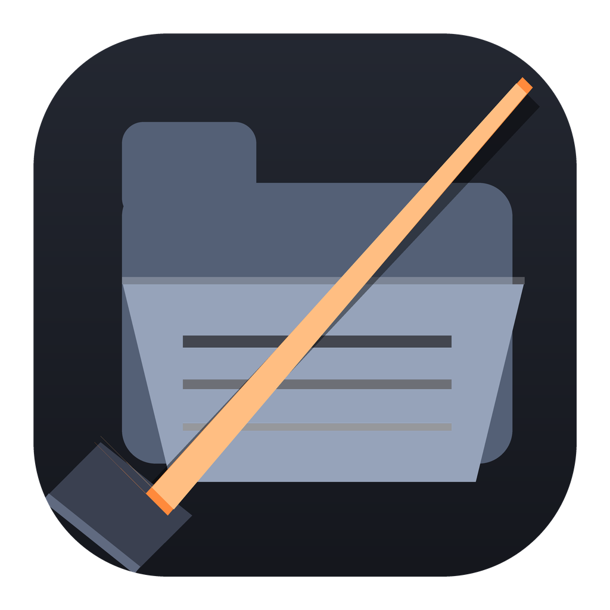

<p align="center">
  
</p>

<h1 align="center">RAZE</h1>

<p align="center">
  <strong>Point-and-shoot removal for stubborn Windows files and folders.<br>Reserved names, 260-character walls, locked handles, broken ACLs — gone.</strong>
</p>

<p align="center"><a href="README.md"><strong>English</strong></a> · <a href="README.ru.md">Русский</a></p>

<p align="center">
  <a href="LICENSE"></a>
  <a href="https://t.me/rercon"></a>
</p>

<p align="center">
  <a href="#development"><strong>Build for Windows</strong></a> ·
  <a href="#quick-start">Quick start</a> ·
  <a href="SECURITY.md">Security</a>
</p>

> [!TIP]
> **One click in Explorer, one confirmation, done.** Install the context-menu
> integration (`raze --install`), right-click any stubborn folder or file,
> and choose **RAZE delete**. Deletion runs without opening the main window;
> the UAC prompt appears only when the object really needs admin rights.

> [!NOTE]
> The `raze` CLI and `raze-app` GUI share the same engine
> (`raze_rs::job`): both decide identically what counts as a problem
> and where an object goes — Recycle Bin or permanent removal.

## What RAZE removes

Windows itself refuses these, and so does every normal tool:

| Obstacle | How RAZE gets past it |
|---|---|
| Reserved names (`NUL`, `CON`, `PRN`, `AUX`, `COM1`–`COM9`, `LPT1`–`LPT9`) | Extended paths (`\\?\...`) switch off name parsing, so `NUL` becomes an ordinary filename |
| Paths longer than 260 characters | Extended paths lift the `MAX_PATH` limit |
| Files held open by other programs | Restart Manager closes holders; optionally `WM_CLOSE` first (`-c`) |
| Ownership and ACL walls | Takes ownership and grants access — only after an actual `ACCESS_DENIED` |
| Junctions, symlinks, other reparse points | Deletes the **link**, never follows or traverses it |
| `ERROR_DELETE_PENDING` objects | Retries until the object is really gone |

Deletion goes through **handles** (`CreateFileW` + `SetFileInformationByHandle`
with `FILE_DISPOSITION_INFO_EX`), not through path-based APIs. There is no
window between "look at the path" and "delete the path" for another process
or a normalization surprise to abuse.

**Honest dispositions:** recyclable objects go to the Recycle Bin and can be
restored; objects the bin cannot hold (reserved names, extended paths) are
removed permanently — and the report says which happened. The check runs
*before* deletion, because the shell silently deletes permanently when the
bin is full. For the same reason RAZE reads the drive's Recycle Bin settings
("don't move files to the Recycle Bin", the size limit, the policy) and plans
such objects as permanent instead of reporting a Recycle Bin that never
happened.

**Safety rails:** volume roots (`C:\`), the system folders themselves
(`C:\Windows`, `C:\Program Files`, `C:\ProgramData`, your profile and their
parents) and the RAZE program folder are refused outright. So is most of what
lies *inside* them: under `C:\Windows` only throwaway folders may be removed
(`Temp`, `Logs`, `Minidump`, `SoftwareDistribution`, `Panther`, `Debug`,
`Prefetch`, the print queue); in `Program Files` the folders that belong to
Windows itself (`WindowsApps`, `Windows *`, `Common Files`); on the system
drive `System Volume Information`, `Recovery`, `Boot`, `EFI`. A path is checked
twice — as typed and as it really lies on disk — so `C:\PROGRA~1` and a path
through a junction into `C:\Windows` are caught too, and the check is repeated
right before deletion. Paths with `* ? " < > |` or an NTFS stream (`:`) are
rejected: the shell would read the first as a mask.

While a tree is being removed every object is verified, through the very
handle that is about to be deleted, to lie inside the target. If a folder was
swapped for a junction in the meantime, the object is skipped and reported, not
deleted.

## Features

- **Two context menus:** the classic registry verb for every Windows, plus the
  modern Windows 11 menu via a COM `IExplorerCommand` shell extension
  (`raze_shell.dll`) and a sparse MSIX package.
- **Point-and-select:** pick individual files and folders, not only whole trees.
- **Preview mode** (`-n`): see the plan — files, folders, links, bytes, problems —
  change nothing.
- **Elevation on demand:** unprivileged first; a UAC relaunch happens only on
  real `ACCESS_DENIED`.
- **GUI and CLI, one brain:** egui window with drag-and-drop, per-target
  checkboxes, blocker badges, dark/light themes, EN/RU.
- **Machine-readable output:** `--json` for scripts, `--plan-only` for a dry plan.

## CLI or GUI

| | `raze` | `raze-app` |
|---|---|---|
| Interface | Terminal | Native window |
| Unattended use | `-y` and arguments | Fields and buttons |
| Adding targets | Arguments, also `%1` from Explorer | Drag-and-drop, browser, typed path |
| Locked-file hunt | `-L` lists holders | `close locks` checkbox |
| Language | `--lang en` / `--lang ru` | EN / RU button in the title bar |

## Installation

Build the Windows x64 binaries using the [development instructions](#development),
then run `raze-app.exe` or `raze.exe` straight from the build folder. To add
**RAZE delete** to Explorer's right-click menu:

```powershell
raze --install
```

This asks for administrator rights **once** (one UAC prompt) and installs RAZE
into `%ProgramFiles%\RAZE`. That folder is writable only by administrators, which
matters: elevation re-runs `raze.exe`, and a copy in a folder any of your own
programs can overwrite could be swapped for something else before the prompt.
A copy left by an earlier version in `%LOCALAPPDATA%\Programs\RAZE` is removed.

The same run writes the classic verbs to `HKCU` and, when `RAZE.msix` and
`RAZE.cer` are next to `raze.exe` (see [Development](#development)), registers
the **modern Windows 11 menu** — the one that opens on a plain right-click,
where the entry reads **Delete with RAZE** (**Удалить с помощью RAZE** on a
Russian Windows). The classic verb lives under *Show more options*.

Windows only accepts menu extensions from signed packages. RAZE's package is
signed with a self-signed certificate (`CN=RERCON RAZE`), so the install adds
its **public** part to `LocalMachine\TrustedPeople` — and only if its
thumbprint matches the one compiled into `raze.exe` (`packaging\cert-thumbprint.txt`).
Nothing else is changed, and no private key is involved. To repeat just that
step: `raze --register-package`. (If you would rather not trust a certificate,
skip `RAZE.msix`/`RAZE.cer`: the classic menu entry works without them.)

To remove everything — the package, the classic verbs, that certificate and the
installed files (one UAC prompt):

```powershell
raze --uninstall
```

The extension never deletes anything itself — it just launches `raze.exe` with
the selected paths, so a crash in Explorer can never corrupt a deletion in
progress. `raze_shell.dll` and `raze.exe` must stay in the same folder.

## Quick start

```powershell
# Preview what would happen
raze -n "C:\Users\name\Desktop\Seller"

# Remove a folder with a NUL inside — Explorer cannot even select it
raze "C:\Users\name\Desktop\Seller"

# Permanent removal, no Recycle Bin
raze --permanent "D:\old\build"

# Close programs that hold the files, then remove
raze -c "C:\temp\locked"

# Who holds this file?
raze -L -n "C:\temp\still-in-use.txt"
```

Multiple paths at once; quote paths with spaces. Without `-y` RAZE asks for
confirmation and prints a plan first — from the context menu it does not
(your click was the confirmation).

| Argument | Purpose |
|---|---|
| `PATH` | Files and folders to remove |
| `-n, --dry-run` | Show what would be removed, change nothing |
| `-p, --permanent` | Remove permanently, bypassing the Recycle Bin |
| `--recycle` | Force the Recycle Bin even where it normally refuses |
| `-y, --yes` | Do not ask for confirmation |
| `-c, --close-locks` | Send `WM_CLOSE` to programs holding the files |
| `--keep-owners` | Never take ownership or change access rights |
| `-L, --find-locks` | Also list the processes holding each file (slower) |
| `--json` | Machine-readable report on stdout |
| `--lang en\|ru` | Interface language |
| `-v` | More detail |

### Language

English is the default. Use the **EN / RU** button next to the theme button
in the GUI title bar, or run:

```powershell
raze --lang ru
raze --lang ru --help
```

## How deletion works

1. **Scan** — walk the tree *without entering reparse points*, classify every
   entry (file / folder / link), probe for blockers (reserved names, locks,
   ACLs) and check the Recycle Bin verdict for each top-level target.
2. **Plan** — decide the disposition per target *before* touching anything.
3. **Remove** — bottom-up, through handles: open with `\\?\`, apply
   `FILE_DISPOSITION_INFO_EX` (`DELETE | POSIX_SEMANTICS | IGNORE_READONLY_ATTRIBUTE`),
   fall back to the legacy disposition info where `Ex` is unavailable.
4. **Verify** — an object is only counted as removed when it is actually gone;
   `DELETE_PENDING` is retried, not assumed.
5. **Report** — per target: mode (Recycle Bin / permanent), counts, freed bytes,
   notes (ownership taken, locks closed) and every failure with its error code.

## Development

Windows x64, Rust 1.88+, Visual Studio Build Tools (MSVC + Windows SDK
10.0.26100), and `windres` (bundled with MSYS2/MinGW-w64) for the icon
resources:

```powershell
packaging\build-package.ps1
cargo build --release --workspace
cargo test --lib --workspace
```

`build-package.ps1` comes first: it packs and signs the sparse package that
gives `raze_shell.dll` an identity (needs `makeappx.exe` and `signtool.exe` from
the Windows SDK). The package is signed with a self-signed certificate whose
private key stays, non-exportable, in *your* user certificate store, so every
builder gets a certificate of their own: the script creates it on first run and
writes its thumbprint to `packaging\cert-thumbprint.txt`, which `cargo build`
compiles into `raze.exe` as the only certificate its installer will trust.
The committed value is the author's; yours replaces it in your working copy.

Artifacts in `target\release`:

| File | What |
|---|---|
| `raze.exe` | CLI |
| `raze-app.exe` | GUI |
| `raze_shell.dll` | COM shell extension for the modern Windows 11 menu |
| `RAZE.msix`, `RAZE.cer` | Signed sparse package and its public certificate (from `build-package.ps1`) |

The shell extension is a `cdylib` loaded into `explorer.exe`: it has no
`unwrap`/`expect` in shared paths, cannot panic, and `Invoke` only spawns
`raze.exe` detached — deletion never runs inside Explorer.

## Security

See [SECURITY.md](SECURITY.md) for the trust model, refusal list, and
shell-extension boundaries.

## License

[GPL-3.0-or-later](LICENSE).
