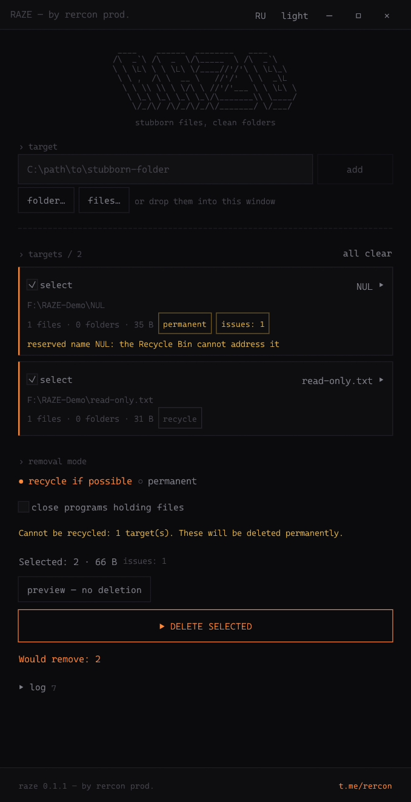
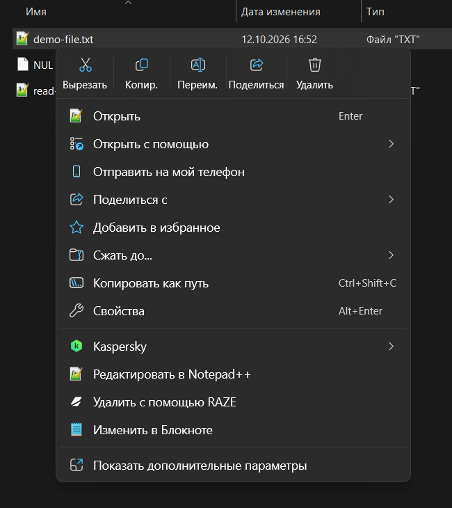

<p align="center">
  
</p>

<h1 align="center">RAZE</h1>

<p align="center">
  <strong>Точечное удаление упрямых файлов и папок в Windows.<br>Зарезервированные имена, стена в 260 символов, занятые дескрипторы, сломанные ACL — всё уходит.</strong>
</p>

<p align="center"><a href="README.md">English</a> · <strong>Русский</strong></p>

<p align="center">
  <a href="LICENSE"></a>
  <a href="https://t.me/rercon"></a>
</p>

<p align="center">
  <a href="#разработка"><strong>Собрать для Windows</strong></a> ·
  <a href="#быстрый-старт">Быстрый старт</a> ·
  <a href="SECURITY.md">Безопасность</a>
</p>

<table>
  <tr>
    <th>Приложение RAZE (на английском)</th>
    <th>Контекстное меню Windows 11</th>
  </tr>
  <tr>
    <td width="50%" align="center">
      <a href="docs/screenshot.png"></a>
    </td>
    <td width="50%" align="center">
      <a href="docs/context-menu.png"></a>
    </td>
  </tr>
</table>

<p align="center"><em>На скриншотах — только искусственные демонстрационные данные. Нажмите на изображение, чтобы открыть его в полном размере.</em></p>

> [!TIP]
> **Один клик в Проводнике — и готово.** Установите интеграцию с контекстным
> меню (`raze --install`), щёлкните правой кнопкой по упрямой папке или файлу и
> выберите **Удалить с помощью RAZE**. Клик и есть подтверждение: больше ничего
> не спрашивается, главное окно не открывается. Запрос UAC появляется только
> тогда, когда объекту действительно нужны права администратора.

> [!NOTE]
> CLI `raze` и окно `raze-app` работают на одном движке (`raze_rs::job`): оба
> одинаково решают, что считать проблемой и куда отправить объект — в Корзину
> или удалить безвозвратно.

## Что удаляет RAZE

Windows отказывается от этого сама, как и любой обычный инструмент:

| Препятствие | Как RAZE его обходит |
|---|---|
| Зарезервированные имена (`NUL`, `CON`, `PRN`, `AUX`, `COM1`–`COM9`, `LPT1`–`LPT9`) | Расширенные пути (`\\?\...`) отключают разбор имён, и `NUL` становится обычным именем файла |
| Пути длиннее 260 символов | Расширенные пути снимают ограничение `MAX_PATH` |
| Файлы, открытые другими программами | Restart Manager находит держателей; по желанию вежливый `WM_CLOSE` обычным приложениям (`-c`) |
| Стены владельца и ACL | Забирает владение и выдаёт доступ — только после настоящего `ACCESS_DENIED` |
| Junction, символические ссылки, другие reparse-точки | Удаляет **саму ссылку**, никогда не идёт по ней и не заходит внутрь |
| Объекты в состоянии `ERROR_DELETE_PENDING` | Повторяет, пока объект действительно не исчезнет |

Безвозвратное удаление идёт через **дескрипторы** (`CreateFileW` +
`SetFileInformationByHandle` с `FILE_DISPOSITION_INFO_EX`), а не через удаление
по пути. Проверяется открытый объект, затем удаляется тот же дескриптор.
Корзина использует API оболочки по пути: её операция не атомарна с
предшествующими проверками пути в RAZE.

**Честный режим удаления.** Что можно вернуть, уходит в Корзину и восстанавливается;
то, что Корзина вместить не может (зарезервированные имена, расширенные пути),
удаляется безвозвратно, и отчёт говорит, что именно произошло. Проверка идёт
*до* удаления, потому что оболочка молча удаляет насовсем, когда Корзина
переполнена. По той же причине RAZE читает настройки Корзины диска («не
перемещать файлы в Корзину», предел размера, политику) и планирует такие
объекты как безвозвратные, а не сообщает о Корзине, которой не было.
Фактический режим определяется по уведомлениям оболочки о завершении, а не
по постановке операции в очередь. Отмена операции Корзины останавливает пакет
и никогда не запускает безвозвратное удаление вместо неё. Перенос в Корзину
не считается освобождением места; для безвозвратного удаления байты — оценка
логического размера, а не измерение занятого места файловой системы.

**Предохранители.** Корни томов (`C:\`), сами системные папки (`C:\Windows`,
`C:\Program Files`, `C:\ProgramData`, ваш профиль и их родители) и каталог самой
программы RAZE отклоняются безоговорочно. Так же — большая часть того, что лежит
*внутри* них: в `C:\Windows` удалять можно только мусорные папки (`Temp`, `Logs`,
`Minidump`, `SoftwareDistribution`, `Panther`, `Debug`, `Prefetch`, очередь
печати); в `Program Files` — папки, принадлежащие самой Windows (`WindowsApps`,
`Windows *`, `Common Files`); на системном диске — `System Volume Information`,
`Recovery`, `Boot`, `EFI`. Путь проверяется дважды — как введён и как он на самом
деле лежит на диске, — поэтому `C:\PROGRA~1` и путь через junction в
`C:\Windows` тоже попадаются, а проверка повторяется прямо перед удалением.
Пути с `* ? " < > |` или потоком NTFS (`:`) отклоняются: оболочка прочитала бы
первые как маску.
Защищённые каталоги получаются через Windows API, а не изменяемые переменные
окружения. Если эти данные или окончательный путь открытой цели недоступны,
удаление отклоняется. Нативные UTF-16 пути сохраняются на всём пути удаления,
включая имена, которые нельзя без потерь представить текстом Unicode.

Пока дерево удаляется, каждый объект проверяется — по тому самому дескриптору,
который сейчас будет удалён, — на принадлежность цели. Если за это время папку
подменили junction'ом, объект пропускается и попадает в отчёт, а не удаляется.

## Возможности

- **Два контекстных меню:** классический пункт реестра для любой Windows и
  современное меню Windows 11 через COM-расширение `IExplorerCommand`
  (`raze_shell.dll`) и разреженный MSIX-пакет.
- **Точечный выбор:** можно отметить отдельные файлы и папки, а не только целые
  деревья.
- **Режим просмотра** (`-n`): показывает план — файлы, папки, ссылки, байты,
  проблемы — и ничего не меняет.
- **Права по требованию:** сначала без прав; перезапуск через UAC случается
  только при настоящем `ACCESS_DENIED`.
- **GUI и CLI — один мозг:** окно на egui с перетаскиванием, флажками по каждой
  цели, значками препятствий, тёмной и светлой темой, EN/RU.
- **Вывод для машин:** `--json` для скриптов, `--plan-only` для сухого плана.

## CLI или окно

| | `raze` | `raze-app` |
|---|---|---|
| Интерфейс | Терминал | Нативное окно |
| Без участия человека | `-y` и аргументы | Поля и кнопки |
| Добавление целей | Аргументы, а также `%1` из Проводника | Перетаскивание, выбор папки, ввод пути |
| Поиск держателей | `-L` показывает держателей | флажок «закрывать программы» |
| Язык | `--lang en` / `--lang ru` | Кнопка RU / EN в заголовке окна |

## Установка

Соберите бинарники для Windows x64 по [инструкции для разработчика](#разработка) и
запускайте `raze-app.exe` или `raze.exe` прямо из папки сборки. Чтобы добавить
**Удалить с помощью RAZE** в контекстное меню Проводника:

```powershell
raze --install
```

Команда **один раз** просит права администратора (один запрос UAC) и ставит RAZE в
`%ProgramFiles%\RAZE`. Это важно: писать в эту папку могут только
администраторы. UAC при повышении перезапускает `raze.exe`, а копию в папке, которую
может переписать любая из ваших программ, успели бы подменить до запроса. Копия
прежней версии из `%LOCALAPPDATA%\Programs\RAZE` очищается с неповышенными
правами исходного пользователя, без привилегированного обхода доступного ему
дерева. Если нужный токен недоступен, установщик просит очистить её вручную.

В том же запуске в `HKCU` пишутся классические пункты и, если рядом с `raze.exe`
лежат `RAZE.msix` и `RAZE.cer` (см. [Разработка](#разработка)), регистрируется
**современное меню Windows 11** — то, что открывается обычным щелчком правой
кнопкой, пункт в нём называется **Удалить с помощью RAZE** (на английской Windows —
**Delete with RAZE**). Классический пункт лежит в «Показать дополнительные параметры».

Windows принимает расширения меню только из подписанных пакетов. Пакет RAZE
подписан самоподписанным сертификатом (`CN=RERCON RAZE`), поэтому установка
добавляет его **публичную** часть в `LocalMachine\TrustedPeople` — и только если
отпечаток совпадает с вшитым в `raze.exe` (`packaging\cert-thumbprint.txt`).
Больше ничего не меняется, закрытый ключ не участвует. Повторить только этот шаг:
`raze --register-package`. (Если не хотите доверять сертификату, не кладите
`RAZE.msix` и `RAZE.cer`: классический пункт работает и без них.)

Чтобы убрать всё — пакет, классические пункты, этот сертификат и установленные
файлы (один запрос UAC):

```powershell
raze --uninstall
```

Расширение само ничего не удаляет — оно только запускает `raze.exe` с выбранными
путями, поэтому сбой в Проводнике не может повредить идущее удаление.
`raze_shell.dll` и `raze.exe` должны лежать в одной папке.

## Быстрый старт

```powershell
# Посмотреть, что произойдёт
raze -n "C:\Users\name\Desktop\Seller"

# Удалить папку с NUL внутри — Проводник её даже выделить не может
raze "C:\Users\name\Desktop\Seller"

# Безвозвратное удаление, без Корзины
raze --permanent "D:\old\build"

# Закрыть программы, которые держат файлы, и удалить
raze -c "C:\temp\locked"

# Кто держит этот файл?
raze -L -n "C:\temp\still-in-use.txt"
```

Путей можно указать несколько; пути с пробелами берите в кавычки. Без `-y` RAZE
сначала печатает план и спрашивает подтверждение — из контекстного меню не
спрашивает (подтверждением был ваш клик).

| Аргумент | Назначение |
|---|---|
| `PATH` | Файлы и папки для удаления |
| `-n, --dry-run` | Показать, что будет удалено, ничего не менять |
| `-p, --permanent` | Удалить безвозвратно, минуя Корзину |
| `--recycle` | Использовать Корзину, где возможно (по умолчанию); запреты безопасности не обходятся |
| `-y, --yes` | Не спрашивать подтверждение |
| `-c, --close-locks` | Отправить `WM_CLOSE` программам, которые держат файлы |
| `--keep-owners` | Никогда не забирать владение и не менять права доступа |
| `-L, --find-locks` | Дополнительно перечислить процессы, держащие каждый файл (медленнее) |
| `--json` | Один итоговый JSON-отчёт в stdout, без баннера и второго объекта плана |
| `--plan-only` | Вывести план без удаления; с `--json` — один объект плана |
| `--lang en\|ru` | Язык интерфейса |
| `-v` | Больше подробностей |

В JSON-режиме RAZE не передаёт работу повышенному дочернему процессу:
ошибки выставляют `needs_elevation` и возвращают ненулевой код завершения.
При необходимости запустите CLI с повышением самостоятельно. В текстовом
режиме передача через UAC означает запуск дочернего процесса, а не успешное
удаление; повторно передаются только цели с ошибками.

### Язык

Если язык ещё не сохранялся, используется английский. Кнопка **RU / EN**
в заголовке GUI сразу сохраняет выбор в `HKCU\Software\RAZE` (`Language`);
после закрытия и повторного запуска он восстанавливается. CLI использует тот
же сохранённый язык. `--lang` меняет язык только текущего запуска и не
перезаписывает настройку:

```powershell
raze --lang ru
raze --lang ru --help
```

## Как работает удаление

1. **Обход** — проходит дерево, *не заходя в reparse-точки*, классифицирует каждый
   объект (файл / папка / ссылка), ищет препятствия (зарезервированные имена,
   блокировки, ACL) и определяет вердикт по Корзине для каждой цели верхнего
   уровня.
2. **План** — режим для каждой цели определяется *до* того, как что-либо тронуто.
3. **Удаление** — снизу вверх, через дескрипторы: открытие по `\\?\`, затем
   `FILE_DISPOSITION_INFO_EX` (`DELETE | POSIX_SEMANTICS | IGNORE_READONLY_ATTRIBUTE`),
   а там, где `Ex` недоступен, — запасной вариант с обычной структурой.
4. **Проверка** — объект считается удалённым, только когда его действительно нет;
   `DELETE_PENDING` повторяется, а не принимается на веру.
5. **Отчёт** — по каждой цели: режим (Корзина / безвозвратно), счётчики, освобождённые
   байты, заметки (забрано владение, закрыты держатели) и каждая ошибка с её кодом.

## Разработка

Windows x64, Rust 1.88+, Visual Studio Build Tools (MSVC + Windows SDK
10.0.26100) и `windres` (входит в MSYS2/MinGW-w64) для ресурсов иконок:

```powershell
packaging\build-package.ps1
cargo build --release --workspace
cargo test --locked --workspace --all-targets --all-features
```

`build-package.ps1` запускается первым: он собирает и подписывает разреженный
пакет, который даёт `raze_shell.dll` идентификатор (нужны `makeappx.exe` и
`signtool.exe` из Windows SDK). Пакет подписан самоподписанным сертификатом, чей
закрытый ключ остаётся — неэкспортируемым — в *вашем* хранилище сертификатов
пользователя, так что у каждого сборщика свой сертификат: скрипт создаёт его при
первом запуске и записывает его отпечаток в `packaging\cert-thumbprint.txt`,
который `cargo build` вшивает в `raze.exe` как единственный сертификат, которому
будет доверять его установщик. Закоммиченное значение принадлежит автору; ваше
заменяет его в вашей рабочей копии.

Артефакты в `target\release`:

| Файл | Что это |
|---|---|
| `raze.exe` | CLI |
| `raze-app.exe` | Окно |
| `raze_shell.dll` | COM-расширение для современного меню Windows 11 |
| `RAZE.msix`, `RAZE.cer` | Подписанный разреженный пакет и его публичный сертификат (из `build-package.ps1`) |

Расширение меню — это `cdylib`, который грузится в `explorer.exe`: в общих путях
в нём нет `unwrap`/`expect`, паниковать оно не может, а `Invoke` лишь запускает
`raze.exe` отдельным процессом — удаление никогда не идёт внутри Проводника.

## Безопасность

Модель доверия, список отказов и границы расширения меню — в
[SECURITY.md](SECURITY.md).

## Лицензия

[GPL-3.0-or-later](LICENSE).
